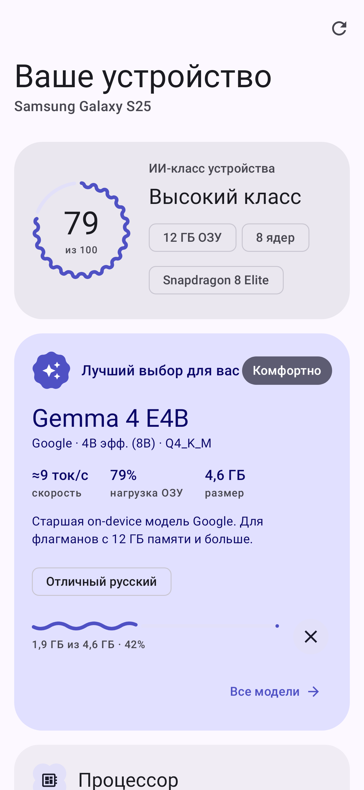
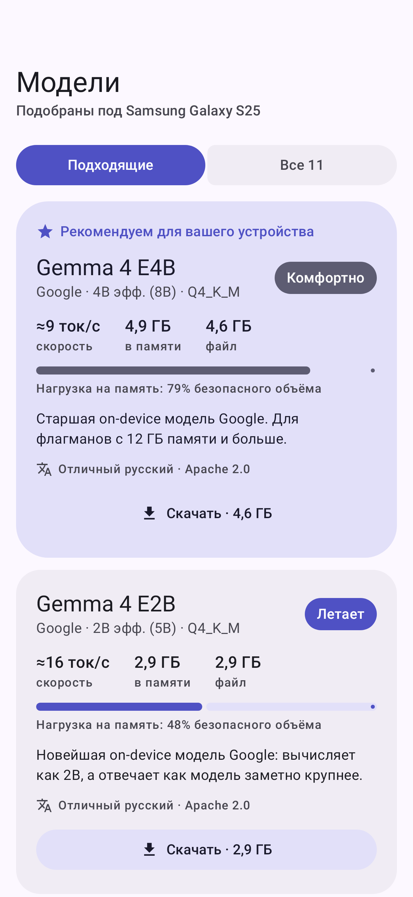
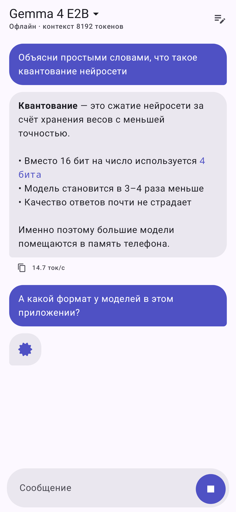

# PocketMind — локальная нейросеть, подобранная под ваш телефон

Android-приложение, которое анализирует железо устройства и предлагает скачать
чат-модель, которая будет работать на нём без перегрузки — полностью офлайн.

**Готовый APK:** [`release/PocketMind-1.0.0.apk`](release/PocketMind-1.0.0.apk) (arm64-v8a, Android 11+).

| Устройство | Модели | Диалог |
|---|---|---|
|  |  |  |

## Что делает

1. **Анализ железа** — чипсет, кластеры ядер и частоты, инструкции DotProd/I8MM/SVE,
   ОЗУ, GPU (через EGL) и версия Vulkan, свободное место, температура, батарея,
   плюс нативный замер пропускной способности памяти (главный фактор скорости LLM).
2. **Подбор модели** (`Recommender.kt`) — безопасный бюджет ОЗУ (35–60% памяти,
   чтобы система не выгружала приложения) и оценка скорости
   «пропускная способность / объём весов на токен». Каждая модель получает
   вердикт: *Летает / Комфортно / Тяжеловато / Не потянет*.
3. **Загрузка** через системный `DownloadManager` (докачка, уведомление,
   проверка размера файла) с Hugging Face — все репозитории публичные.
4. **Диалог** на встроенном движке [llama.cpp](https://github.com/ggml-org/llama.cpp)
   (JNI): шаблон чата самой модели, переиспользование KV-кэша между репликами,
   потоковый вывод, остановка генерации.

Каталог: SmolLM2 360M, Qwen3.5 0.8B/2B/4B/9B, Llama 3.2 1B/3B, Gemma 3 1B,
Gemma 4 E2B/E4B, Vikhr Qwen2.5 1.5B (русскоязычная). Все — GGUF Q4_K_M.

## Технологии

- Kotlin, Jetpack Compose, **Material 3 Expressive** (MaterialExpressiveTheme,
  волнистые индикаторы, LoadingIndicator, формы MaterialShapes, flexible app bars)
- Material You dynamic color, edge-to-edge, predictive back, адаптивная
  навигация (NavigationSuiteScaffold — нижняя панель / rail на планшетах)
- Navigation 3, ViewModel + StateFlow, DataStore, корутины
- targetSdk / compileSdk **37 (Android 17)**, AGP 9.4, Kotlin 2.4
- llama.cpp с вариантами CPU-бэкенда, выбираемыми в рантайме (от Cortex-A53 до Armv9 + SME), KleidiAI

## Сборка

```bash
git submodule update --init
./gradlew :app:assembleRelease      # нужен Android SDK 37 и NDK 29.0.14206865
./gradlew :app:testDebugUnitTest    # юнит-тесты подбора
./gradlew :app:recordRoborazziDebug # скриншоты экранов в app/screenshots
```

Релиз подписывается демо-ключом из `signing/` — замените его своим перед публикацией.
